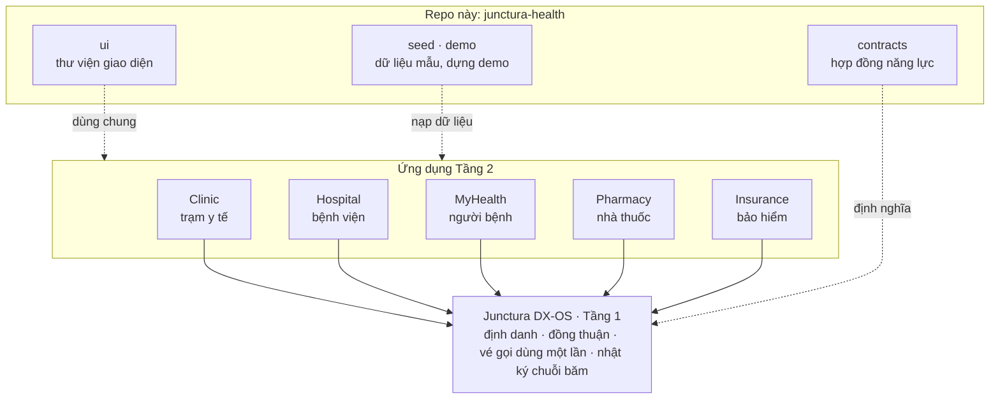
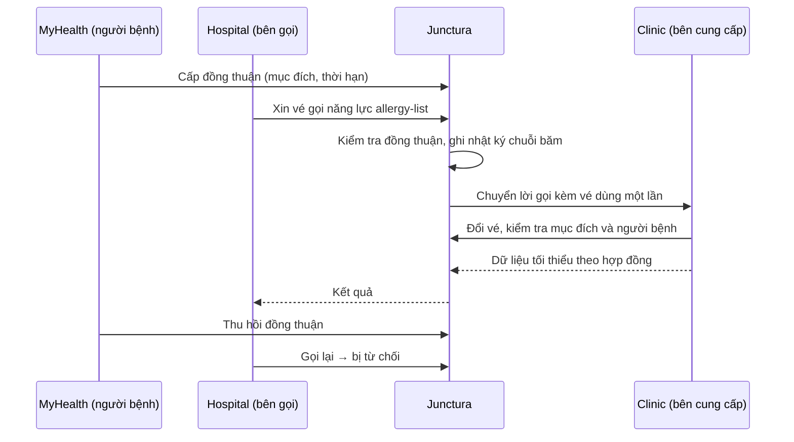

<!-- SPDX-FileCopyrightText: 2026 Junctura Contributors -->
<!-- SPDX-License-Identifier: Apache-2.0 -->

<div align="center">


# Junctura Health

**Trao đổi dữ liệu y tế giữa trạm y tế, bệnh viện, nhà thuốc và bảo hiểm — chỉ khi người bệnh đồng ý, chỉ phần cần thiết, và mọi lần truy cập đều để lại dấu vết.**

[](https://github.com/vku2-open-source-2026/junctura-health/actions/workflows/ci.yml)
[](https://www.npmjs.com/package/@junctura/health-contracts)
[](LICENSE)
[](REUSE.toml)

[Giới thiệu](#giới-thiệu) · [Kiến trúc](#kiến-trúc) · [Hợp đồng năng lực](#hợp-đồng-năng-lực) · [Bắt đầu nhanh](#bắt-đầu-nhanh) · [Tài liệu](#tài-liệu) · [Lộ trình](#lộ-trình)

</div>

---

## Giới thiệu

Một người bệnh khám ở trạm y tế xã rồi được chuyển lên bệnh viện. Bệnh viện hỏi lại tiền sử, dị ứng, tiêm chủng; giấy chuyển tuyến đi bằng tay; nhà thuốc không biết đơn có xung đột dị ứng hay không; bảo hiểm phải xin cả hồ sơ để kiểm tra một khoản chi. Dữ liệu nằm rải rác, hoặc bị chia sẻ nhiều hơn mức cần thiết.

**Junctura Health** là Tầng 2 (lĩnh vực y tế) xây trên [Junctura DX-OS](https://github.com/vku2-open-source-2026/junctura-dxos). Mỗi bên giữ dữ liệu của mình và chỉ trả lời khi được hỏi qua Junctura, theo một **hợp đồng năng lực** định nghĩa trước dữ liệu vào, dữ liệu ra, bên được gọi và mục đích được phép. Repo này là **repo tổng hợp** của bộ năm ứng dụng: hợp đồng dùng chung, thư viện giao diện dùng chung, dữ liệu mẫu giả lập và công cụ dựng môi trường demo.

### Ai làm gì trong luồng này

| Bối cảnh | Ứng dụng | Junctura Health giúp gì |
| --- | --- | --- |
| **Trạm y tế xã** | Clinic | Giữ hồ sơ ban đầu, tiêm chủng, lập phiếu chuyển tuyến; chỉ trả lời khi người bệnh đồng ý |
| **Bệnh viện** | Hospital | Tiếp nhận chuyển tuyến với hồ sơ tóm tắt và cảnh báo dị ứng; truy cập cấp cứu có ghi lý do và hậu kiểm |
| **Người bệnh** | MyHealth | Cấp và thu hồi đồng thuận, xem ai đã truy cập dữ liệu của mình |
| **Nhà thuốc** | Pharmacy | Xác minh đơn thuốc và dị ứng trước khi phát |
| **Bảo hiểm** | Insurance | Xác minh chi phí chỉ bằng câu trả lời có/không, không nhận hồ sơ |

## Tính năng nổi bật

**Nguyên tắc cốt lõi**
- **Người bệnh quyết định:** mỗi truy cập cần đồng thuận, đúng mục đích; thu hồi được bất cứ lúc nào.
- **Chỉ chia sẻ phần cần thiết:** dữ liệu trả về nhỏ nhất theo hợp đồng. Bảo hiểm chỉ nhận có/không, không nhận hồ sơ.
- **Cấp cứu có kiểm soát:** truy cập khẩn cấp phải ghi lý do và được rà soát sau.
- **Có thể kiểm chứng:** nhật ký chuỗi băm không sửa được; người bệnh xem lại ai đã truy cập dữ liệu của mình.
- **An toàn khi hiển thị:** danh sách dị ứng rỗng luôn hiện là "chưa ghi nhận", không bao giờ là "không dị ứng" (trường `allergyState`).

**Trong repo này**
- Sáu hợp đồng năng lực, phát hành trên npm thành [`@junctura/health-contracts`](https://www.npmjs.com/package/@junctura/health-contracts).
- Thư viện giao diện React dùng chung cho cả năm ứng dụng, phát hành thành [`@junctura/health-ui`](https://www.npmjs.com/package/@junctura/health-ui).
- Bộ sinh dữ liệu mẫu: 50 người bệnh giả lập ở Đà Nẵng, cùng seed luôn cho cùng kết quả.
- Công cụ dựng môi trường demo: một lệnh tạo 55 tài khoản, đăng ký 5 ứng dụng, công bố 6 năng lực và cấp quyền.

## Kiến trúc



Các ứng dụng không gọi thẳng nhau và không đọc cơ sở dữ liệu của nhau. Bên gọi xin vé từ Junctura; bên cung cấp đổi vé, kiểm tra đồng thuận và mục đích, rồi mới trả dữ liệu.

### Một lần chia sẻ dữ liệu diễn ra thế nào



### Các ứng dụng

| Repo | Vai trò |
| --- | --- |
| [junctura-dxos](https://github.com/vku2-open-source-2026/junctura-dxos) | Tầng 1: định danh, đồng thuận, vé gọi, nhật ký chuỗi băm, Console quản trị |
| **junctura-health** (repo này) | Hợp đồng năng lực, thư viện giao diện, dữ liệu mẫu, môi trường demo |
| [junctura-clinic](https://github.com/vku2-open-source-2026/junctura-clinic) | Trạm y tế xã: hồ sơ, hàng chờ khám, tiêm chủng, chuyển tuyến |
| [junctura-hospital](https://github.com/vku2-open-source-2026/junctura-hospital) | Bệnh viện: tiếp nhận chuyển tuyến, cảnh báo dị ứng, truy cập cấp cứu |
| [junctura-myhealth](https://github.com/vku2-open-source-2026/junctura-myhealth) | Sổ sức khỏe: cấp và thu hồi đồng thuận, xem ai đã truy cập |
| [junctura-pharmacy](https://github.com/vku2-open-source-2026/junctura-pharmacy) | Nhà thuốc: xác minh đơn thuốc trước khi phát |
| [junctura-insurance](https://github.com/vku2-open-source-2026/junctura-insurance) | Bảo hiểm: xác minh chi phí, chỉ nhận có/không |

## Hợp đồng năng lực

Định nghĩa một lần trong [`contracts/`](contracts/README.md), cài bằng `npm install @junctura/health-contracts`.

| Năng lực | Bên cung cấp | Bên gọi | Mục đích | Cấp cứu |
| --- | --- | --- | --- | --- |
| `pre-visit-summary` | Clinic | Hospital | `treatment` | Có |
| `allergy-list` | Clinic | Hospital, Pharmacy | `treatment`, `dispensing` | Có |
| `vaccination-history` | Clinic | Hospital | `treatment` | Không |
| `referral-summary` | Clinic | Hospital | `referral_intake` | Không |
| `prescription-verify` | Hospital | Pharmacy | `dispensing` | Không |
| `claim-verify` | Hospital | Insurance | `claim_review` | Không |

## Bắt đầu nhanh

**Yêu cầu:** Git, Node.js 24 (xem `.node-version`). Dựng môi trường demo cần thêm Docker và [junctura-dxos](https://github.com/vku2-open-source-2026/junctura-dxos) đặt cạnh repo này.

### Build từ mã nguồn và kiểm thử

```sh
git clone https://github.com/vku2-open-source-2026/junctura-health.git
cd junctura-health
npm run check
npm test
```

Có sẵn `../junctura-dxos` (hoặc đặt `JUNCTURA_DXOS_DIR`) thì `npm test` còn đối chiếu hợp đồng với bộ kiểm tra của chính Junctura.

### Dựng môi trường demo

```sh
# 1. Trong thư mục junctura-dxos
npm run setup
npm run local:up

# 2. Trong repo này
npm run demo:setup
```

`demo:setup` tạo 55 tài khoản demo, đăng ký 5 ứng dụng, công bố 6 năng lực và cấp quyền gọi theo bảng trên; chạy lại nhiều lần vẫn an toàn. Chi tiết, cổng và file sinh ra: [`demo/README.md`](demo/README.md). Sau đó chạy từng ứng dụng theo README của nó, ví dụ [junctura-clinic](https://github.com/vku2-open-source-2026/junctura-clinic#readme).

> Chạy cả bộ bằng một lệnh `docker compose` đang được hoàn thiện, theo dõi ở [Issues](https://github.com/vku2-open-source-2026/junctura-health/issues).

### Lệnh thường dùng

| Lệnh | Tác dụng |
| --- | --- |
| `npm run check` | Kiểm tra cú pháp mã nguồn và tính hợp lệ của hợp đồng |
| `npm run check:reuse` | Kiểm tra tuân thủ REUSE 3.3 (cần `pip install -r requirements-reuse.txt`) |
| `npm test` | Hợp đồng, dữ liệu mẫu, logic dựng demo |
| `npm run demo:setup` | Dựng môi trường demo trên Junctura DX-OS |
| `npm run ui:install` · `ui:test` · `ui:build` | Cài, kiểm thử, build thư viện giao diện |
| `npm run ui:preview` | Trang xem thử mọi thành phần giao diện |

## Công nghệ

| Thành phần | Công nghệ |
| --- | --- |
| Hợp đồng, công cụ demo, dữ liệu mẫu | Node.js 24 (JavaScript ESM) |
| Thư viện giao diện | React 19, Vite, TypeScript, Tailwind |
| SDK Tầng 1 | [`@junctura/server-client`](https://www.npmjs.com/package/@junctura/server-client) |
| Đóng gói, CI | npm, GitHub Actions |

Thư viện bên thứ ba được khai trong `package.json` và `package-lock.json`, cài từ registry; không chép mã nguồn của chúng vào repo.

## Tài liệu

| | |
| --- | --- |
| [docs/new-app.md](docs/new-app.md) | Dựng một ứng dụng Tầng 2 mới, từng bước |
| [docs/APPS.md](docs/APPS.md) | Tính năng và dữ liệu của từng ứng dụng; ranh giới phần AI |
| [docs/DESIGN.md](docs/DESIGN.md) | Nguyên tắc thiết kế, quy tắc an toàn hiển thị |
| [docs/UX.md](docs/UX.md) | Người dùng, luồng việc, bố cục |
| [contracts/README.md](contracts/README.md) | Quy tắc hợp đồng và cách đổi hợp đồng |
| [seed/README.md](seed/README.md) | Bộ sinh dữ liệu mẫu giả lập |
| [demo/README.md](demo/README.md) | Môi trường demo, cổng, file sinh ra |
| [CHANGELOG.md](CHANGELOG.md) | Lịch sử thay đổi |

## Cấu trúc thư mục

```text
contracts/   hợp đồng năng lực (npm: @junctura/health-contracts)
ui/          thư viện giao diện (npm: @junctura/health-ui)
seed/        bộ sinh dữ liệu mẫu giả lập, xác định theo seed
demo/        dựng môi trường demo trên Junctura DX-OS
docs/        thiết kế, UX, tính năng từng ứng dụng, hướng dẫn dựng app mới
skills/      skill thiết kế giao diện cho người và Claude Code
tests/       kiểm thử hợp đồng, dữ liệu mẫu, demo
scripts/     kiểm tra cú pháp và tuân thủ REUSE
```

Dữ liệu mẫu là **50 người bệnh giả lập ở Đà Nẵng** do [`seed/`](seed/README.md) sinh ra; không có thông tin người thật.

## Kiểm thử

```sh
npm run check         # cú pháp và hợp đồng
npm run check:reuse   # REUSE 3.3
npm test              # hợp đồng, dữ liệu mẫu, demo
npm run ui:test       # thư viện giao diện
```

GitHub Actions chạy cả bốn lệnh ở mỗi Pull Request.

## Lộ trình

- [x] **Hợp đồng năng lực** 1.0 và 1.1 (thêm `allergyState`), phát hành trên npm.
- [x] Thư viện giao diện dùng chung, dữ liệu mẫu và môi trường demo.
- [x] Clinic cung cấp bốn năng lực qua Junctura.
- [ ] Hospital, MyHealth, Pharmacy, Insurance hoàn thiện theo hợp đồng.
- [ ] Chạy cả bộ bằng một lệnh `docker compose`.
- [ ] Bản phát hành `v0.1.0` kèm gói `.tar.gz`.

## Đóng góp

Mọi đóng góp đều được hoan nghênh. Báo lỗi và đề xuất tại [Issues](https://github.com/vku2-open-source-2026/junctura-health/issues); trước khi gửi Pull Request, đọc [CONTRIBUTING.md](CONTRIBUTING.md). Commit theo chuẩn Conventional Commits và không bao giờ commit tệp `.env` hay khóa bí mật. Lịch sử thay đổi: [CHANGELOG.md](CHANGELOG.md).

## Giấy phép

Junctura Health là phần mềm tự do, phát hành theo [Apache License 2.0](LICENSE), một giấy phép nguồn mở được OSI phê chuẩn — Copyright 2026 Junctura Contributors. Bạn được dùng, sửa đổi và phân phối lại (kể cả cho mục đích thương mại), miễn là giữ lại thông báo bản quyền và giấy phép, ghi rõ các thay đổi; giấy phép cũng cấp quyền sử dụng bằng sáng chế liên quan và không kèm bảo hành.

<!-- REUSE-IgnoreStart -->
- Mỗi tệp mã nguồn đều ghi giấy phép bằng tiêu đề [SPDX](https://spdx.dev/) (`SPDX-License-Identifier: Apache-2.0`); các tệp không chứa được chú thích (JSON, dữ liệu) được khai báo trong [REUSE.toml](REUSE.toml). Dự án tuân thủ chuẩn [REUSE 3.3](https://reuse.software/), kiểm tra bằng `reuse lint`.
<!-- REUSE-IgnoreEnd -->
- Toàn văn giấy phép: [LICENSE](LICENSE) · thông báo bản quyền: [NOTICE](NOTICE).
- Thành phần bên thứ ba giữ giấy phép riêng và đều là giấy phép nguồn mở; chúng được khai trong `package.json`, cài từ registry, không chép hay sửa mã nguồn.
